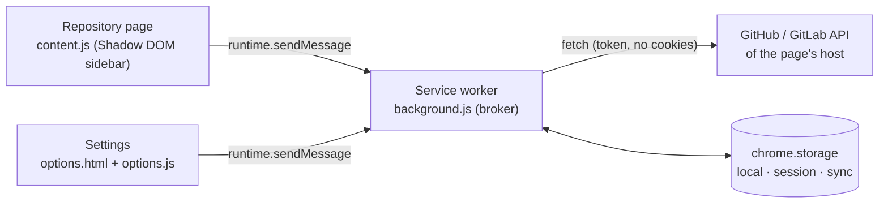

# Architecture

Codetree is a Manifest V3 extension with three execution contexts. Each has one entry point in `src/`, bundled by esbuild into one classic script in `build/`.

| Context | Entry | Responsibility |
| --- | --- | --- |
| Service worker | `src/background/index.js` | Trusted broker: accounts and tokens, API requests, caches, Viewed marks, bookmarks, preferences, Sync, OAuth. |
| Content script | `src/content/index.js` | Sidebar, full-file viewer and View full buttons on GitHub/GitLab pages. Holds no tokens. |
| Settings | `src/options/index.js` | Appearance, navigation, Sync and account management. Requests optional permissions. |

`src/shared/` contains side-effect-free modules used by all three: preferences and shortcuts, routes and URLs, the tree model, full-file diff validation and the original icons.

## Messages

Pages and Settings send `{type, context?, …}` to the worker and receive `{ok: true, value}` or `{ok: false, error, status?}`. Errors remain redacted; an optional integer HTTP status (400–599) lets file tabs distinguish missing files from other preview failures. The broker checks every message against its sender before doing anything:

| Type | Sender | Purpose |
| --- | --- | --- |
| `STATE` | page, Settings | Public state: preferences, accounts without tokens, hosts, account selections, bookmarks; Sync status for Settings. |
| `PREFERENCES` | page, Settings | Save preferences. Pages may not change the default pin state. |
| `WINDOW_PIN` | page | Pin the sidebar in the sender's window and notify that window's tabs. |
| `FILE_TABS` | page (own host) | Read/save session-only file-workspace metadata, isolated by browser tab, account and repository/review scope. |
| `BOOKMARK` | page | Add or remove a bookmark on an enabled host. |
| `SELECT_ACCOUNT` | page (own host), Settings | Choose the account for a host, or `auto`. |
| `OPTIONS` | page, Settings | Open Settings. |
| `ADD_ACCOUNT`, `REMOVE_ACCOUNT` | Settings | Connect a PAT after verifying it, or remove an account. |
| `SYNC_SETTINGS` | Settings | Enable, disable or re-run browser Sync. |
| `OAUTH_*` | Settings | OAuth availability, GitHub device flow, GitLab PKCE sign-in. |
| `INIT`, `TREE`, `BRANCHES`, `PULLS`, `DIFF`, `FILE`, `VIEWED`, `REFRESH` | page (own host) | Repository data for the page's validated context. |

Repository requests are dispatched to `providers/github.js` or `providers/gitlab.js` by the configured provider of the host. A page can only request data from its own origin, and only from enabled hosts.

## Service worker

| Module | Role |
| --- | --- |
| `index.js` | Message router, sender checks, error redaction, lifecycle listeners. |
| `storage.js` | Trusted local storage (`TRUSTED_CONTEXTS`), serialized writes, window pins (session storage), local Viewed marks. |
| `file-tabs.js` | Validated, bounded session metadata for in-page file workspaces; serialized reads/writes and stale-account save checks. |
| `cache.js` | Memory cache (80 entries / 12 MiB) with request deduplication; persisted tree cache (48 entries / 4 MiB / 24 h). Clears use generations so stale replies are never cached. |
| `http.js` | Streaming body limits and list budgets (10,000 items / 32 MiB). |
| `client.js` | Host-bound API client: token header, `credentials: 'omit'`, `redirect: 'error'`, 25 s timeout, pagination, GraphQL, OAuth refresh. |
| `hosts.js`, `validate.js` | Enabled hosts, context validation, account selection, identifier validation. |
| `accounts.js` | Public state, account verification and removal, content scripts for custom hosts. |
| `sync.js` | Opt-in Sync snapshot of whitelisted preferences and bookmarks. |
| `oauth/` | Public client IDs and the device/PKCE/refresh flows. |
| `providers/` | GitHub REST/GraphQL and GitLab REST adapters. |

### Stored data

| Area | Key | Contents |
| --- | --- | --- |
| local | `preferences`, `accounts`, `selectedAccounts`, `bookmarks`, `localViewed` | Read through `readStore`; written through `writeStore`. Accounts include tokens. |
| local | `treeCache` | Persisted trees by account, host, repository and revision. |
| local | `syncSettings` | This device's Sync state. |
| session | `windowPins`, `oauthDevice` | Pins chosen with the window pin button (other windows follow the default); pending GitHub device authorization. |
| session | `fileTabs` | Open file paths, active path, opaque native-route identity and branch/revision scroll positions; no text/comments and no Sync. |
| sync | `codetreeSyncSnapshot` | Only when Sync is enabled: preferences and bookmark URLs/titles/dates. |

## Content script

`app.js` composes the sidebar from feature factories. Each factory `createX(app)` receives the shared `app` object and returns its functions, which are merged into `app`; features call each other through `app` only at run time.

| Module | Role |
| --- | --- |
| `state.js` | Mutable state and request generations (`epoch`, `filesGeneration`, `viewGeneration`, `refreshGeneration`, `branchGeneration`). |
| `reactive.js`, `reactive-dom.js` | Dependency-free signals, lazy memos, synchronous render/effect queues and owners; owned listeners, shared animation frames and debounced values. |
| `page.js`, `dom.js` | Page context, theme and wording; DOM helpers using `textContent` only. |
| `navigation.js` | Page loads, header, tabs, Refresh. |
| `sidebar/view.js`, `layout.js`, `render.js` | Shadow DOM elements, placement and page padding, tab rendering. |
| `sidebar/files.js`, `tree.js` | Tree loading and lazy folders; virtualized rows, keyboard navigation, Viewed marks. |
| `viewed.js`, `viewer/file-review.js` | Revision-bound Viewed publication and owned PR/MR Viewed-and-next controls shared by the tree, file tabs and View full. |
| `sidebar/file-icons.js` | file-icons rule matching and glyph rendering. |
| `sidebar/branches.js`, `pulls.js`, `bookmarks.js` | Branch popover, request list and filters, bookmarks. |
| `viewer/` | Full-file diff and comments dialog; lexical highlighting. |
| `viewer/file-tabs.js`, `viewer/file-content.js` | In-page workspace lifecycle/metadata and shared bounded, virtualized text/diff rendering. |
| `native/header-buttons.js` | View full buttons in native diff headers. |

Every asynchronous reply is applied only if the generations captured at its start still match, so navigation, Refresh, tab or filter changes cannot be overwritten by an older reply. The race regressions in `tests/` exercise these rules through the factories.

In-page file tabs use `FILE_TABS` with `scope: 'code'|'review'` and an optional complete metadata `value`. Reads return paths, active path, positions, opaque page identity and a broker-derived `accountID`; saves echo that account ID and reject mismatches, including account changes while queued. Storage keys derive the sender's browser tab ID and selected account, provider, origin, owner/repository and scope. Code shares paths across branches; review adds its validated PR/MR number or commit SHA. Positions are keyed by branch or exact review revisions. `src/shared/file-tabs.js` shares the 32-file/256-position limits; the broker also bounds storage to 50 workspaces and 64 KiB per entry, validates saved metadata on read and never persists text. Session operations do not touch other keys. New workspace behavior still requires installed-browser verification.

`file-content.js` projects validated unified diff rows into paired old/new rows without re-fetching revisions or re-running highlighting. Both split panes virtualize the same row range and synchronize scrolling. The page-local `diffLayout` signal updates tabs and dialogs together; it is not a stored preference. Viewport adapters translate saved tab positions to/from unified row coordinates, keeping the existing `FILE_TABS` schema.

`viewer/file-search.js` owns the current file's find controls and capture-phase keyboard listener. It scans the complete validated row list with escaped, case-insensitive Unicode matching, retaining at most 10,000 source-offset ranges. Debounced scans yield between chunks and reject replies after query changes or disposal. Ranges are keyed by the original row objects, so split context is counted once and painted in both panes. `file-content.js` splits syntax text nodes at match boundaries and translates result navigation through the existing unified-coordinate viewport adapter. Queries and match metadata stay in the owned viewer, with no broker, storage or Sync changes.

`viewer/file-line.js` validates one-based source-line input against the complete rows and maps New / Old line numbers to a unified row before the renderer projects it into either layout. File search owns one shared input: Ctrl/Cmd+F selects literal search, while Ctrl/Cmd+G explicitly selects line mode and prefills `:`. The prefix is parsed only in line mode, so a text query such as `:223` stays literal; switching back restores the previous search query. Both modes preserve modal priority, native editor shortcuts and Close's last position. Revealing a line uses the existing viewport and tab-position save path; the controller adds no persisted fields or API requests.

`viewer/file-selection.js` owns one source revision and anchored line range per rendered file. Delegated line-number interactions update that range, while `file-content.js` paints only the matching visible rows and keeps the selection through layout projection. The footer actions copy either the selected revision's complete source text or a native permalink built by `shared/line-links.js` from its exact commit and source path. GitLab fork metadata supplies the authoritative source project namespace when available; unresolved namespaces disable permalink copying. Clipboard completion feedback is bound to the current selection and viewer lifetime. Selection adds no storage fields, Sync data, shortcuts or clipboard permissions, and is discarded with the file's owner.

`viewer/file-changes.js` groups contiguous non-context rows into change blocks once per diff render. Owned SVG icon buttons navigate cyclically through unified source boundaries; `file-content.js` maps them to the active layout, reveals virtualized rows and reuses tab-position persistence without fetching again. The counter follows the viewport, retaining a selected block while visible even when scrolling clamps at the file end. Scroll updates find nearby block boundaries by binary search. The controller adds no shortcuts, preferences or storage fields and is disposed with its viewer content.

View fields in `state.js` are signal-backed accessors, so factories keep the `state.x = value` syntax. `expanded` is replaced with a new Set and compared by contents. Generations, tree entries, the tree model and keyboard focus stay plain fields. `updateTree()` invalidates one tree derivation after structural changes; expansion and the debounced search invalidate it directly. Multi-field updates use `batch`. Files status is stored once; the visible `loading`/`error` accessors choose between Files and list status without copying on tab switches.

The app root owns sidebar bindings and global listeners. Each navigation disposes its page root, closes its viewer and branch popover, removes native buttons and clears pending folder requests. Page liveness checks complement request generations. Each viewer shell owns its scroll listener and frames, and releases them on close or replacement. `catchError` on the app root reports computation errors as a toast; feature actions run untracked. Settings uses the same primitives with separate preference, account, OAuth and Sync bindings and listens for stored preference changes.

Render effects update tab chrome, persistent toolbar controls, the active body, notices, header and layout independently. Hidden tabs do not subscribe to their data. All tab counts respect search; request and bookmark counts share their matching lists with the body through lazy memos. Tree rows remain imperative and virtualized; one binding schedules the viewport through the shared frame queue. Provider-driven theme reads and native-header insertion also stay imperative. Identical page-style text is not rewritten.

## Build and package

1. `npm run build` runs `scripts/build.mjs`: esbuild bundles the three entry points (`format: iife`, `target: chrome140`, unminified) and copies the manifest, Settings page, icons and file-icons fonts into `build/`. Chrome 140 is required for trusted-only local and Sync storage access. `scripts/styles.mjs` compiles SCSS with Sass: sidebar and Settings CSS are written to `build/`, while native-control CSS is embedded in the content bundle. Provider palettes keep runtime CSS variables for live site theme changes.
2. During bundling, `scripts/file-icons.mjs` generates `virtual:file-icons` from `vendor/file-icons/`: rules, glyph metrics and theme colours evaluated from Atom's Less sources.
3. `scripts/package.py` packages `build/` with `PRIVACY.md`, `THIRD_PARTY_NOTICES.md` and `LICENSE` into a reproducible `dist/codetree-<version>.zip`.
4. `scripts/check.mjs` validates the manifest and assets against a fresh bundle, plus repository consistency.

See [Checks and releases](RELEASING.md) for CI and publication.

## Tests

`npm test` runs Node.js regressions without a browser:

- `core.test.mjs`: full-file diff validation.
- `split-diff.test.mjs`: View full layout controls, aligned old/new rows, synchronized/clamped scrolling, source-line positions, font/viewport changes and disposal through the production viewer with synthetic geometry.
- `viewer-search.test.mjs`: the shared Find/Go to line field, literal colon queries, Old/New source-line mapping in both layouts, invalid/empty revision feedback, keyboard guards and stale-scan/disposal checks through the production viewer. Search coverage includes Unicode ranges across syntax tokens, complete virtualized-file navigation and result limits.
- `viewer-changes.test.mjs`: change-block counts, cyclic navigation, virtual row reveal, manual scrolling, split projection, clamped positions and owned controls through the production View full dialog.
- `viewer-review.test.mjs`: Viewed-and-next acknowledgement ordering, listed-file traversal, completion, retries and stale-view disposal through View full in both layouts and provider modes.
- `file-tabs.test.mjs`: file navigation and session restoration, including Split diff positions, source-line jumps and change-block counters across file/review switches, branches, Refresh and page reload, plus independent inline/dialog scrolling and shortcut priority with a shared layout. Viewed-and-next coverage checks confirmed marks, metadata-save retries, manual navigation intent and stale replies.
- `hosts.test.mjs`: request contexts built like the content script's, and rejected branch/path segments.
- `hide-rules.test.mjs`: regex and wildcard URL exclusions, validation, persisted rules, URL query/fragment boundaries and code-only scope.
- `viewed.test.mjs`: Viewed marks through the bundled service worker in a VM with mocked APIs.
- `window-pins.test.mjs`: the default pin edited by Settings and per-window pins chosen with the pin button, through the bundled service worker.
- `content-races.test.mjs`, `navigation-races.test.mjs`: request generations through the content factories with controlled reply order.
- `reactive.test.mjs`, `reactive-dom.test.mjs`: dependency graphs, lazy equality cutoffs, render/effect ordering, owners, error draining and listener/frame/timer cleanup.
- `sidebar-reactive.test.mjs`: persistent control focus, searched counts, background Files status, header updates, atomic diff rows, account rollback and keyboard tab stops through the content factories with synthetic DOM/RPC fixtures.
- `options-reactive.test.mjs`: stored and normalized preferences, unsaved form preservation (including edits of fields that another save did not change), Sync errors and OAuth timer cleanup through the bundled Settings entry point with synthetic browser events.
- `release.test.mjs`: release and store workflow behavior.

Browser behavior, authenticated APIs and store publication need the manual checks in [Contributing](../CONTRIBUTING.md) and [Verification](VERIFICATION.md).
